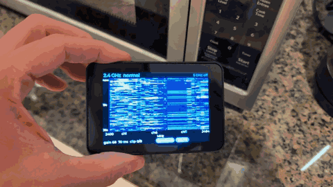
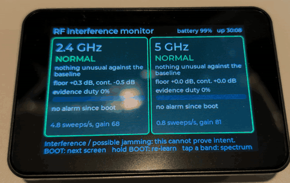
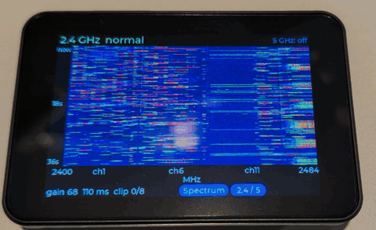
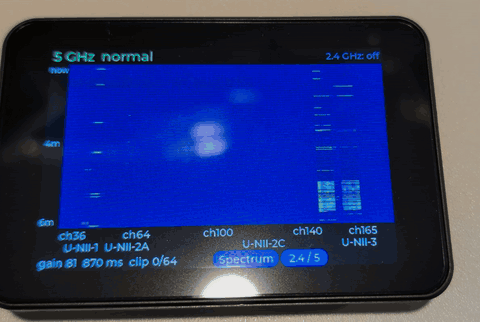
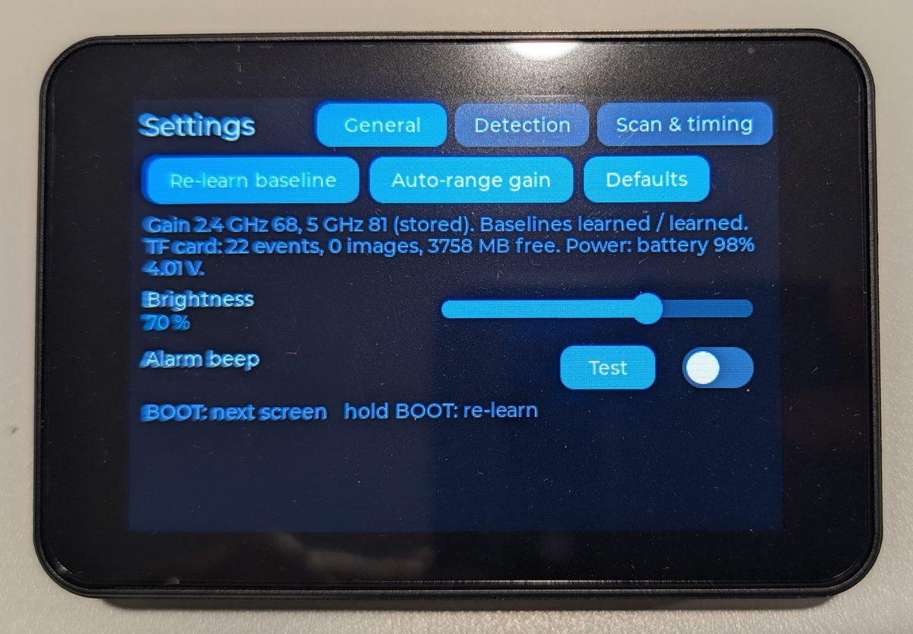
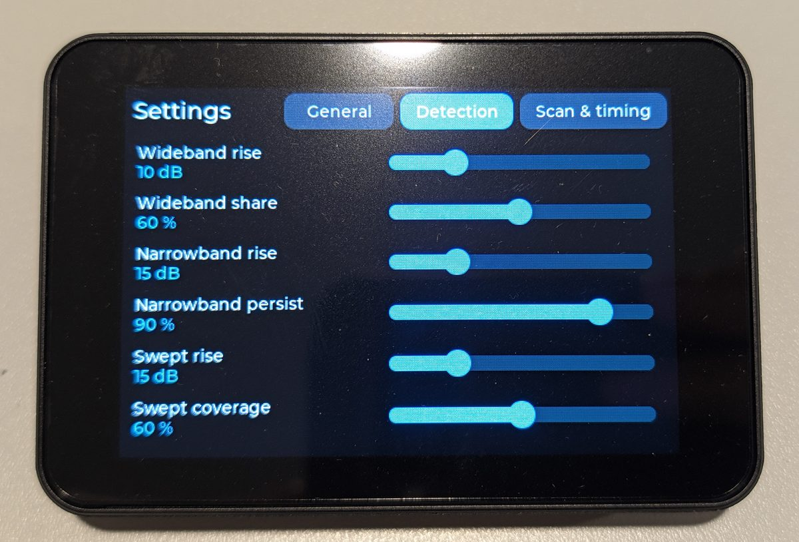
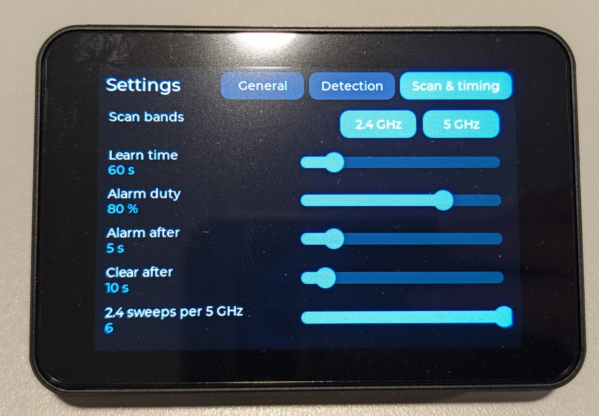

# esp-wifi-jammer-detector

A **receive-only** 2.4 GHz + 5 GHz RF interference / possible-jamming detector
for the Waveshare **ESP32-C5-Touch-LCD-3.5**. It uses the ESP32-C5's own Wi-Fi
receiver as a snapshot SDR (via [ESPARGOS esp-sdr](https://github.com/ESPARGOS/esp-sdr))
and shows the noise floor and spectrum on the built-in touchscreen.

It never transmits, injects or deauthenticates anything. It can show that the
RF environment changed; it cannot prove intent. A microwave oven will look
like interference on 2.4 GHz.

## Features

- **Standalone:** runs entirely on the ESP32-C5 board; no PC, phone or
  network needed.
- **Both Wi-Fi bands:** sweeps 2400–2483.5 MHz and 5150–5895 MHz in 48 MHz
  slices at 80 MS/s, stitched into one spectrum per band (312.5 kHz bins).
  About 4.5 sweeps/s on 2.4 GHz and one 5 GHz sweep every 0.83 s.
- **Single-band mode:** turn either band off; 2.4 GHz alone runs at about
  12 sweeps/s.
- **Learns normal:** a 60 s per-bin baseline, stored in flash and tracked for
  slow drift.
- **Four detectors:** raised wideband floor, persistent narrowband carrier,
  swept signal and pulsed wideband energy, with NORMAL / SUSPECT / ALARM
  states.
- **Alarms:** flashing red border and an optional beep through the on-board
  speaker.
- **Screens:** status tiles per band, live spectrum (~10 fps) with max-hold
  and baseline, scrolling waterfall, and touch settings for every threshold.
- **TF-card logging:** a CSV row for every state change. About 2 minutes
  after each alarm, a BMP of the waterfall with the alarm row in the middle.
- **Battery level** from the AXP2101 power chip.
- **Home Assistant:** plug the detector into the Home Assistant machine and
  install the bridge app from this repository. Alarms, readings, events and
  every setting appear as a device through MQTT discovery
  ([ha_addon/jammer_detector_bridge](ha_addon/jammer_detector_bridge/DOCS.md)).
  The USB protocol works with any other host too ([docs/LINK.md](docs/LINK.md)).
- **Receive only:** no transmit, injection or deauth code, and Wi-Fi
  networking is off while scanning.

## On the device

### Microwave oven test (2.4 GHz)

A running microwave oven next to the device: the 2.4 GHz waterfall fills with
pulsed wideband energy and the status screen goes to SUSPECT ("pulsed energy,
busy Wi-Fi or microwave oven?"). 5 GHz scanning is off here.

[](docs/media/microwave-2g4.mp4)

Click the GIF for the full 33 s video with sound (MP4, 5.4 MB).

### Screens

| Status screen | 2.4 GHz waterfall (5 GHz off) | 5 GHz waterfall (2.4 GHz off) |
|---|---|---|
|  |  |  |

| Settings: General | Settings: Detection | Settings: Scan & timing |
|---|---|---|
|  |  |  |

## Flash a release (no build)

Download `esp-wifi-jammer-detector-vX.Y.Z-merged.bin` from
[Releases](https://github.com/TheDigital1/ESP-WiFi-Jam-Detector/releases) and
write it at offset 0 with esptool 5 (`pip install esptool`; on esptool 4 the
command is `esptool.py ... write_flash`):

```sh
esptool --chip esp32c5 -p /dev/ttyACM0 -b 460800 write-flash 0x0 esp-wifi-jammer-detector-v1.0.0-merged.bin
```

Use the board's USB-C port (`COMx` on Windows). This keeps your settings and
learned baselines; the separate `bootloader.bin` (0x2000),
`partition-table.bin` (0x8000) and app (0x10000) are attached too, with
`SHA256SUMS`.

## Build and flash

The receiver depends on private PHY internals of one exact ESP-IDF commit, so
use that commit and nothing else:

| | |
|---|---|
| ESP-IDF | `25fe69f946311abdaf9ad56591f25fedbc20ac98` (6.2-dev), from esp-sdr's `firmware-targets.json` (`esp32c5`) |
| esp-sdr | `f86da81807b7f6e850742f6b789d9468c190ad41`, vendored in `components/espsdr_rx` |
| LVGL | 9.5.0 (component manager) |
| esp_codec_dev | 1.5.11 (component manager), as in Waveshare's factory demo |

```sh
mkdir -p ~/esp/esp-idf-espsdr && cd ~/esp/esp-idf-espsdr
git init && git remote add origin https://github.com/espressif/esp-idf.git
git fetch --depth 1 origin 25fe69f946311abdaf9ad56591f25fedbc20ac98 && git checkout FETCH_HEAD
git submodule update --init --recursive --depth 1
./install.sh esp32c5

. ~/esp/esp-idf-espsdr/export.sh
cd esp-wifi-jammer-detector
idf.py set-target esp32c5      # first time only
idf.py build
idf.py -p /dev/ttyACM0 flash monitor
```

`idf.py flash` also writes the partition table. Settings, gains and baselines
live in their own NVS partition, `jd_nvs` (256 KB at 0x410000); to start from
scratch, erase it with `parttool.py --port /dev/ttyACM0 erase_partition
--partition-name jd_nvs` (or `idf.py erase-flash`).

On Linux, ModemManager may grab the board's USB port and reset it. Stop it, or
add a udev rule with `ENV{ID_MM_DEVICE_IGNORE}="1"` for USB vendor `303a`.

Host unit tests (no board needed): `make -C test_host`. This also generates
the synthetic spectra for the detector tests with `tools/sim_spectra.py`
(Python 3, standard library only).

## Using it

- **BOOT** short press cycles the screens: status → spectrum → settings.
  **Long press (1.5 s)** re-learns both baselines from any screen.
- **Status** (default): one tile per band, coloured by state (grey learning,
  green normal, amber suspect, red interference), with the floor rise against
  the baseline, an evidence-duty bar (ALARM needs 80 %), the last alarm (as
  uptime) and the sweep rate. Tap a tile for its spectrum.
- **Spectrum:** the current average (cyan, filled), max-hold (orange) and the
  learned baseline (grey) in relative dB, with Wi-Fi channel ticks and U-NII
  labels. **2.4 / 5** switches band, **Reset max** clears max-hold.
  **Waterfall** switches the plot to a scrolling history: one row per sweep,
  newest at the top, coloured by dB above the baseline (dark blue −5 dB →
  cyan → yellow → red +30 dB; absolute level while learning). The left margin
  shows the age of the rows. History (236 sweeps, ~2–4 min) is kept for both
  bands all the time.
- **Settings:** three tabs (General, Detection, Scan & timing) instead of a
  scrolling list, because a full-screen LVGL redraw costs ~80 ms of CPU here
  and scrolling ran at a few frames/s while starving the sweep. Re-learn,
  auto-range gain, defaults; detection thresholds, sweep weighting and
  brightness (applied when a slider is released, saved to
  flash 2 s later or when leaving the screen); alarm beep on/off and **Test**.
  The General tab also shows the TF-card and power status.
- **Scan bands** (Scan & timing tab): 2.4 GHz and 5 GHz can each be turned
  off; one always stays on. With 5 GHz off, 2.4 GHz is swept about 12 times
  a second instead of about 4.5. A band that is off shows **OFF** on the
  status screen, never alarms, and its detector restarts from NORMAL (baseline
  kept) when it is turned back on.
- Any ALARM flashes a red border on every screen. With **Alarm beep** on, it
  also beeps three times (2 kHz) on entering ALARM and every 15 s while it
  lasts. The codec, I2S and amplifier only run during a beep; with beeps
  playing continuously the floor did not move (5 GHz within 0.1 dB, 2.4 GHz
  within normal Wi-Fi variation), so a beep cannot keep an alarm going.
- **Event log:** with a FAT-formatted TF card inserted (and DIP switch JP8
  pin 2 ON, per Waveshare's BSP), every state change is appended to
  `/jd_events.csv` on the card: boot number, uptime, band, from/to state,
  kind and all detector metrics. The card is optional.
- **Alarm snapshots:** with a card in, each time a band enters ALARM its
  waterfall is saved once the alarm row has scrolled to the middle of the
  plot (about 2 minutes later at the default sweep rate), so the image shows
  as much before the alarm as after it. Files go to `/waterfall/` on the card
  as `boot<N>_up<S>s_<band>_<kind>.bmp`, matching the `boot` and `uptime_s`
  columns of the CSV. The image has the band, kind, uptime, frequency axis,
  colour scale and a red mark on the alarm row, with times relative to it.
  One image per alarm; a second alarm before the image is saved is in it.
- **Battery:** the status screen header shows `USB`, `battery NN%` or
  `charging NN%` from the AXP2101 fuel gauge, read every 5 s.
- **Home Assistant:** needs an MQTT broker (e.g. the Mosquitto broker app)
  and the MQTT integration. In **Settings → Apps → App store → ⋮ →
  Repositories** add this repository's URL, install **Jammer Detector
  Bridge**, pick the detector's port (`Espressif USB JTAG serial debug unit`)
  and start it. A **Jammer Detector** device appears with an alarm, state,
  interference kind, floor rise, occupancy and event entity per band, battery,
  and controls for re-learn, beep, bands scanned and every threshold.
  Details and an example notification: [DOCS.md](ha_addon/jammer_detector_bridge/DOCS.md).
- **USB link:** the protocol under the bridge. While a host sends commands,
  the device sends a status line every 10 s and on every state change, one
  line per event (the same fields as the TF-card log), and takes commands to
  re-learn and to change any setting (applied and saved as if changed on the
  screen). Open the port with DTR and RTS both high, or the board resets.
  Format and examples: [docs/LINK.md](docs/LINK.md).
- **First boot:** the receiver auto-ranges its gain (~8 s) and stores it, then
  learns the baseline for 60 s and stores it. Keep the RF environment normal
  during learning: anything present then becomes "normal". **Later boots**
  restore both and are watching within ~3 s; re-learn (long press) after
  moving the device. **Auto-range gain** in Settings re-ranges and re-learns.

## How it works

### Receiver

Snapshot capture from the C5 Wi-Fi receiver through esp-sdr's debug path:
up to 16,380 complex 10-bit samples per snapshot, with reception stopped
between snapshots. Tuning above 3000 MHz selects the 5 GHz RF path.

### Band plan (measured in M3)

Captures run at **80 MS/s with the widest analog filter**, and the central
**48 MHz** of each 1024-point FFT is kept. That span was the flattest option
measured (within about ±1.5 dB, and the filter is −13 dB at Nyquist, so no
aliasing); 40 MS/s left only about ±15 MHz flat and needed 25 tunes for 5 GHz
instead of 16.

| Band | Range | Tunes (centres) | Grid |
|---|---|---|---|
| 2.4 GHz | 2400–2483.5 MHz | 2 (2424, 2472 MHz) | 268 bins × 312.5 kHz |
| 5 GHz | 5150–5895 MHz | 16 (5174 … 5894 MHz, 48 MHz steps) | 2384 bins × 312.5 kHz |

5 GHz sub-bands are labelled U-NII-1 (5150–5250), U-NII-2A (5250–5350),
U-NII-2C (5470–5730) and U-NII-3 (5735–5895); 5350–5470 MHz is swept but
not labelled.

Per tune: 4 snapshots (configurable), Hann window, Q15 fixed-point FFT (the C5
has no FPU), average power and per-snapshot max, DC spike notched (±2 bins),
then 4 FFT bins are reduced to one 312.5 kHz grid bin and stitched into the
band spectrum. The schedule sweeps 2.4 GHz twice for every 5 GHz sweep.

### Gain

Gain is fixed per band while sweeping: hardware AGC would hide a raised noise
floor. On first boot (or from Settings) an auto-range steps down from the top gain index until
clipping across the whole band is at most 100 ppm of samples, then backs off
2 more indices. Typical result here: 2.4 GHz ≈ 65–70, 5 GHz ≈ 81. The result
is stored and reused at every boot, because a baseline is only valid at the
gain it was learned at.

### Measured timing (M3, this board)

| | |
|---|---|
| Full 2.4 GHz sweep | ~0.12 s |
| Full 5 GHz sweep | ~1.3 s |
| Per tune | retune + DC recalibration ~25–30 ms at 5 GHz (~7 ms at 2.4 GHz), ~2–5 ms per snapshot, ~2 ms FFT per snapshot |
| Spectrum display | ~10 frames/s |

On the status and settings screens the UI uses much less CPU, so sweeps run
faster (M5: ~0.08 s and ~0.83 s).

### Self-interference and the radio-quiet window

LCD SPI traffic measurably affects the 2.4 GHz receiver: with the display
redrawing during captures the floor rose up to ~3 dB at 2462 MHz (no effect at
5 GHz). The firmware therefore never lets an LCD DMA transfer overlap a
capture (`board_rf_quiet_begin/end`). Captures take precedence; a capture
waits at most for the strip already in flight.

### Tasks and CPU (single core)

| Task | Priority | Notes |
|---|---|---|
| LVGL / UI | 11 | short bursts, mostly waiting on LCD DMA; the plot is drawn straight to the panel in strips, not through LVGL |
| sweep | 10 (12 during each ~2 ms capture) | CPU-bound; yields 10 % for detect and idle |
| detect | 9 | one band spectrum per completed sweep; a sweep is dropped (counted) rather than block the sweep |
| link_tx, link_rx | 2 (12 while writing) | USB link; each message is written inside a radio-quiet window, and dropped rather than waited for |

The brief asked for the sweep to have the highest priority. Below the sweep,
the UI only managed about 1 frame/s, because the 25 ms 5 GHz retunes starved
it. With the UI on top it still takes only the CPU it really uses (about 25 %).

### Detection (M4)

The receiver is uncalibrated, so detection looks for **change against a
learned baseline**, per band (`main/detect.c`, no ESP-IDF headers, host-tested).

Per sweep the detector gets, for every 312.5 kHz bin, the **mean**, **min** and
**max** power over the tune's K snapshots. The min matters: energy present in
every snapshot (a jammer, a CW tone) raises it, bursty Wi-Fi mostly does not.

- **Baseline:** for 60 s, the median per bin of the mean spectrum, and per
  10 MHz cell the median of the 20th-percentile floor (mean and min spectra).
  Afterwards it follows slow changes (clipped EMA, ~1 dB per 30 sweeps at
  most) only while the band is NORMAL with no evidence. A gain change
  re-learns.
- **Metrics** (logged every 10 s and on every state change): floor rise per
  cell (median and max), continuous (min-spectrum) floor rise, share of cells
  raised, occupancy (bins ≥ 6 dB over the cell's baseline floor), per-cell
  duty over the window, spectral flatness of the most raised cell, clipping,
  narrowband cluster, swept-peak tracker.
- **Evidence:**

| Kind | Condition (defaults) | Can alarm |
|---|---|---|
| wideband | min-spectrum floor ≥ 10 dB up in ≥ 60 % of cells | yes |
| narrowband | ≤ 16 bins (5 MHz) whose min power is ≥ 15 dB over baseline in ≥ 90 % of the last 5 s of sweeps, with quiet shoulders | yes |
| swept | a narrow peak ≥ 15 dB moving steadily one way (sawtooth wraps allowed) for ≥ 4 sweeps, covering ≥ 60 % of the band | yes |
| pulsed wideband | mean-spectrum floor ≥ 10 dB up in ≥ 60 % of cells, or ≥ 50 % of snapshots clipped | SUSPECT only |

- **State per band:** NORMAL → SUSPECT (evidence in 2 consecutive sweeps) →
  ALARM (SUSPECT ≥ 5 s and alarm-capable evidence in ≥ 80 % of the last 5 s of
  sweeps) → NORMAL (no alarm-capable evidence for 10 s). SUSPECT returns to
  NORMAL after 5 s without evidence. Every transition is logged with metrics.
- All thresholds are in `detect_config_t` (`detect_default_config()`); M5 will
  make them editable and persist them.

Host tests (`test_host/test_detect.c`) replay 160 s of synthetic sweeps per
scenario from `tools/sim_spectra.py` (60 s learning, event from 70 s to 130 s)
with the real sweep timing and the default thresholds:

| Scenario | 2.4 GHz | 5 GHz |
|---|---|---|
| clean (AP, beacons, BLE, fixed spurs) | normal | normal |
| busy Wi-Fi (iperf-like 80–90 % airtime on several channels) | suspect (pulsed), no alarm | normal |
| wideband floor +15 dB / +12 dB | ALARM wideband after ~7 s | ALARM wideband after ~8 s |
| CW tone +25 dB / +20 dB | ALARM narrowband after ~11 s | ALARM narrowband after ~12 s |
| swept tone (20 s / 40 s sawtooth) | ALARM swept after ~19 s | ALARM swept after ~32 s |
| microwave oven (50 Hz gated, drifting carrier) | suspect (pulsed) | normal |
| slow 4 dB floor drift | normal | normal |

All of them also pass with other random seeds (`sim_spectra.py --seed`).

## Known limits

- **Snapshot gaps:** each snapshot lasts 12.8 µs (1024 samples at 80 MS/s),
  taken a few milliseconds apart. Short or low-duty-cycle bursts can be missed.
  Detection must rely on statistics over many sweeps.
- **Uncalibrated dB:** all levels are relative (gain-table indices are not
  dB), so detection compares against a learned baseline, not absolute dBm.
- **5 GHz sweep time** is about 1.3 s, dominated by per-frequency DC
  recalibration in the receiver.
- **Bursty vs continuous:** a jammer that is only on part of the time, busy
  Wi-Fi and a mains-gated microwave oven all look alike at this time
  resolution; they reach SUSPECT ("pulsed wideband"), not ALARM. Busy 2.4 GHz
  Wi-Fi can therefore show amber. Inverter microwave ovens run nearly
  continuously and may alarm.
- **Single-channel interference** that is continuous and as wide as a Wi-Fi
  channel (20–160 MHz) is indistinguishable from a saturated Wi-Fi link and is
  not flagged; narrowband needs ≤ 5 MHz and wideband ≥ 60 % of the band.
- **Swept detection** needs the sweep to be slow compared with our own
  sweep (seconds per pass); a fast sweep looks like wideband or pulsed
  energy instead.
- **Stored baseline:** the baseline from the last learning (refreshed hourly
  from the slow EMA) is restored at boot. After moving the device to a
  different RF environment, re-learn, or it may alarm or miss things.
- **Flash writes:** saving the 5 GHz baseline (~10 KB) takes up to ~0.6 s
  and can cost one 2.4 GHz sweep (logged as dropped).
- **Alarm time** is uptime: the PCF85063 RTC is never set, because there is no
  network time while the radio scans. The event log's `boot` column (a counter
  in NVS) tells boots apart.
- **TF-card writes** share SPI2 with the LCD and run inside the radio-quiet
  window, so the sweep pauses for the write (typically tens of ms). A
  ~300 KB alarm snapshot is written 32 rows at a time with 300 ms gaps, so
  the sweep keeps running between the pieces. Saving stops with under 2 MB
  free on the card.
- **Battery percentage** is the AXP2101's own fuel gauge, uncalibrated for
  the attached cell; untested here without a battery fitted.
- **No Wi-Fi networking:** while sweeping, the radio is retuned constantly, so
  normal Wi-Fi (scan/connect/AP) is not available.
- Normal Wi-Fi start-up runs the PHY's own calibration once at boot, as on every
  ESP32. Retunes use esp-sdr's receive-only DC recalibration with no TX
  loopback.

## Source layout

```
components/board/      Waveshare board support (pins cited in include/board_pins.h)
components/espsdr_rx/  ESP32-C5 receiver vendored from esp-sdr (see VENDORED.md)
main/bandplan.c        tune centres and frequency grid (host-tested)
main/dsp.c             window, FFT, dB, percentiles, DC notch (host-tested)
main/detect.c          baseline, metrics, heuristics, state machine (host-tested)
main/detector.c        detector task: assembles band spectra, logs transitions
main/plot.c            spectrum renderer (host-tested)
main/sweep.c           sweep task, auto-range, stitched spectra
main/lvgl_port.c       LVGL display/touch glue, PSRAM allocator
main/settings.c        settings, gains and baselines in NVS (jd_nvs partition)
main/settings_values.c settings defaults and range check (host-tested)
main/audio.c           alarm beep via ES8311 + NS4150B (esp_codec_dev)
main/eventlog.c        TF-card CSV log of detector state changes, BMP writer
main/link.c            USB link tasks (docs/LINK.md)
main/link_proto.c      USB link message format and command parser (host-tested)
main/params.c          adjustable settings table, shared by the screen and the link (host-tested)
main/ui.c              screen switching, BOOT button, alarm border
main/ui_status.c       status screen (default)
main/ui_spectrum.c     spectrum screen and waterfall
main/ui_settings.c     settings screen
main/characterize.c    optional receiver/LCD measurements (CONFIG_JD_CHARACTERIZE)
test_host/             host unit tests
ha_addon/              Home Assistant app: USB-to-MQTT bridge (jdbridge/, tests/)
repository.yaml        makes this repository a Home Assistant app repository
tools/sim_spectra.py   synthetic spectra for the detector tests
```

## Licence

GPL-3.0-or-later (see `LICENSE`), because it includes code from ESPARGOS
esp-sdr (GPL-3.0-or-later, Copyright ESPARGOS contributors). Third-party
notices are in `NOTICE`.
